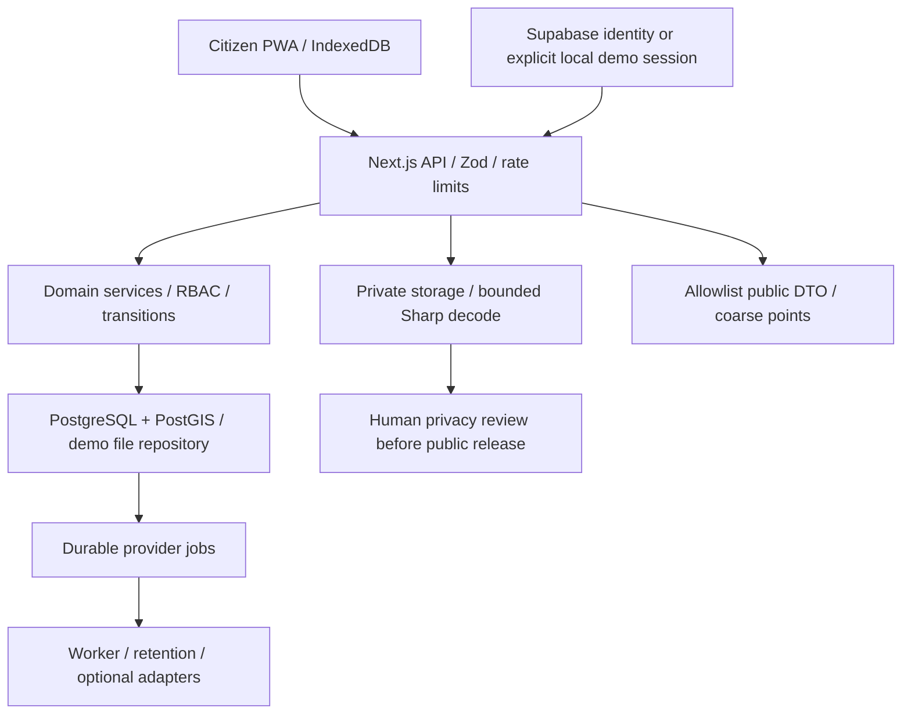
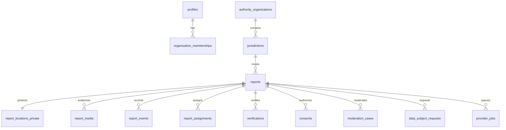

# Architecture and schema/API freeze

Trust boundaries: public client, authenticated citizen, authority scoped to membership/jurisdiction, moderator, privacy/security, infrastructure. Roles never come from request bodies or user-editable metadata. Supabase identity is verified server-side; controlled application profiles define roles and database memberships define jurisdiction scopes. Development sessions are unavailable outside explicit demo mode. Database and service keys stay on the server.

Primary contracts: UUID internal/client IDs, random public ID, hashed private tracking token; reports never embed exact coordinates. Private-location table contains geography(Point,4326); public geometry is a snapped point. Spatial lookup uses ST_Covers and duplicate search uses ST_DWithin with GiST indexes. Read/write boundary schemas disallow extra fields. Public serializers use explicit allowlists. Privileged mutations run in repository transactions and create chained audit entries. API base `/api/v1`; see API.md for frozen endpoints. Media keys are random, private and never accepted as arbitrary remote URLs.

The ER diagram is the intended contract topology. Active repositories persist reports, private locations, media, events, audits, jurisdictions, profiles, sessions, rights requests and provider jobs; memberships are read directly for real identity scopes. Other requested tables reserve integration contracts and do not yet have dedicated normalized writers. The Postgres implementation currently reads JSONB state snapshots under a global transaction advisory lock, with real spatial SQL for routing/duplicates. Replace this with scoped queries and lease-based jobs before production scale. Runtime uses the constrained `denguespot_runtime` permission group from migration 002; schema-owner credentials are for migrations only.
