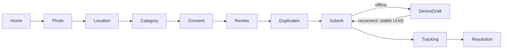
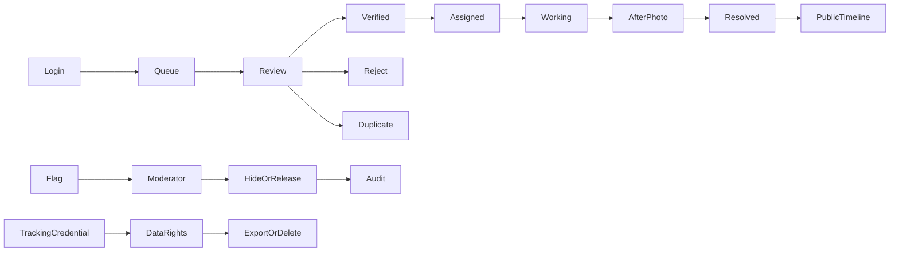

# UX contracts

Three reporting steps group evidence, location/details, and review/consent. Photo/GPS never leave the device before consent. GPS permission is requested only by a user action. Numeric inputs and a location note work without map tiles. Errors use a focusable summary and live announcement; controls have labels and large hit areas. Bangla/English switch preserves the current route. Map content always has a list alternative.

Authority review starts with sanitized evidence. Exact GPS access requires a separate authenticated endpoint and is logged. Status actions are sequential, server validated, and cannot resolve without evidence. QR includes only an opaque public ID. Tracking credential is displayed only to its reporter and must never be encoded in a public QR.
